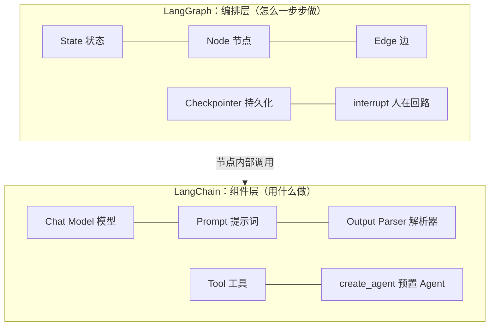
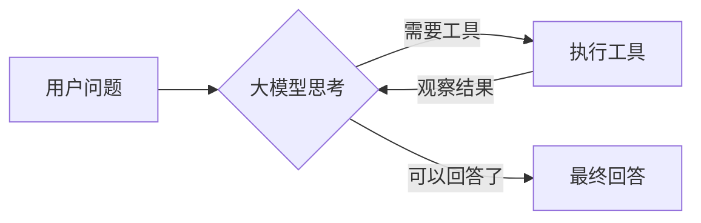

# 第 0 章：概览 —— LangChain 与 LangGraph 是什么

## 1. 从“调用大模型”到“Agent 应用”

直接调用大模型 API 只能做到“一问一答”。真正的应用往往还需要：

| 需求 | 例子 |
| --- | --- |
| 管理提示词 | 同一个翻译功能，要支持不同语言、不同风格 |
| 解析输出 | 让模型输出 JSON，并校验字段 |
| 调用外部能力 | 查天气、查数据库、执行计算 |
| 多步骤流程 | 先分类，再分别处理；失败了要重试 |
| 记忆 | 记住同一个用户上一轮说过什么 |
| 人工把关 | 转账、删数据之前要人确认 |

**LangChain** 和 **LangGraph** 就是为解决这些问题而生的两个配套框架。

## 2. 两者的分工

- **LangChain**（`langchain` / `langchain-core`）：提供**积木**。统一的模型接口（换模型不改代码）、提示词模板、输出解析、工具定义、LCEL 链式组合，以及开箱即用的 `create_agent`。
- **LangGraph**（`langgraph`）：提供**流程编排**。用“图”描述多步骤、有分支、有循环、需要记忆和人工介入的流程。`create_agent` 的底层其实就是一个 LangGraph 图。

一句话：**LangChain 负责“每一步做什么”，LangGraph 负责“步骤之间怎么流转”。**

## 3. 什么时候用哪个？

| 场景 | 推荐 |
| --- | --- |
| 单次调用：翻译、摘要、信息抽取 | LangChain 的 Prompt + Model + Parser 链 |
| 标准的“会用工具的聊天助手” | LangChain 的 `create_agent`（底层是 LangGraph） |
| 需要自定义流程：路由、并行、循环、审批、多 Agent 协作 | LangGraph 手写 `StateGraph` |
| 长时间运行、可中断恢复的任务 | LangGraph + Checkpointer |

## 4. Agent 的本质

Agent = **大模型 + 工具 + 循环**：

这个“思考 → 行动 → 观察”的循环叫做 **ReAct** 模式。本教程会带你先用 LangChain 理解每个组件，再用 LangGraph 亲手把它们组装成这个循环。

## 5. 学习路线

| 章节 | 框架 | 你会学到 |
| --- | --- | --- |
| 1 模型与消息 | LangChain | 消息类型、invoke、stream |
| 2 提示词与 LCEL 链 | LangChain | 模板、管道符 `\|`、结构化输出 |
| 3 工具与工具调用 | LangChain | `@tool`、tool_calls、ToolMessage |
| 4 LangGraph 基础 | LangGraph | State、Node、Edge、Reducer、并行 |
| 5 条件边与循环 | LangGraph | 路由、循环、递归上限 |
| 6 手写 ReAct Agent | 两者结合 | MessagesState、ToolNode、create_agent |
| 7 记忆与人在回路 | LangGraph | Checkpointer、thread_id、interrupt、Command |
| 8 综合项目 | 两者结合 | 一个带知识库、计算、笔记审批、记忆的学习助理 |

## 6. 关于测试中的“假模型”

真实大模型的输出不可预测且需要付费，不适合自动判题。所以测试中使用 `tutorial_kit.FakeToolChatModel`：它按预先写好的“剧本”依次回复（包括发起工具调用），并记录收到了什么消息。

因为 LangChain 对所有模型提供**统一接口**，你的代码面对假模型和真模型完全一样 —— 这本身就是 LangChain 的核心价值之一。测试通过后，配置 `.env` 即可用真实模型运行每章的 demo。
