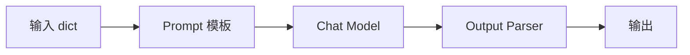

# 第 2 章：提示词模板与 LCEL 链（LangChain）

> 练习：`exercises/ch02_prompts_chains.py`　验证：`uv run python check.py 2`

## 1. 关键概念

### 1.1 提示词模板 ChatPromptTemplate

把提示词中会变化的部分写成 `{变量}`，调用时再填充：

```python
from langchain_core.prompts import ChatPromptTemplate

prompt = ChatPromptTemplate.from_messages([
    ("system", "你是{domain}领域的专家，回答要通俗易懂。"),
    ("human", "{question}"),
])
print(prompt.input_variables)        # ['domain', 'question']

prompt_value = prompt.invoke({"domain": "医学", "question": "什么是免疫力？"})
prompt_value.to_messages()           # -> [SystemMessage(...), HumanMessage(...)]
```

### 1.2 MessagesPlaceholder：给“一串消息”留位置

对话历史的条数不固定，不能用 `{变量}` 表示，要用占位符：

```python
from langchain_core.prompts import MessagesPlaceholder

prompt = ChatPromptTemplate.from_messages([
    ("system", "你是客服"),
    MessagesPlaceholder("chat_history"),   # 调用时传入消息列表
    ("human", "{input}"),
])
prompt.invoke({"chat_history": [...], "input": "..."})
```

### 1.3 Runnable 与 LCEL

LangChain 中几乎所有组件（模板、模型、解析器、工具……）都是 **Runnable**，都有 `invoke / stream / batch`。

**LCEL**（LangChain Expression Language）用管道符 `|` 把 Runnable 串起来，前一个的输出就是后一个的输入：

```python
from langchain_core.output_parsers import StrOutputParser

chain = prompt | llm | StrOutputParser()
#   dict  ->  消息列表  ->  AIMessage  ->  str
chain.invoke({"domain": "医学", "question": "什么是免疫力？"})
```



组成的链本身也是 Runnable，所以同样可以 `stream`、`batch`，也可以继续和别的链拼接。

### 1.4 RunnableLambda：把普通函数接入链

```python
from langchain_core.runnables import RunnableLambda

to_upper = RunnableLambda(lambda s: s.upper())
add_mark = RunnableLambda(lambda s: s + "!")
(to_upper | add_mark).invoke("hi")      # "HI!"
(to_upper | add_mark).batch(["a", "b"]) # ["A!", "B!"]
```

### 1.5 结构化输出

程序需要的往往不是一段话，而是**结构化数据**。两种方式：

**方式一：输出解析器（任何模型都可用，本章练习）**

```python
from pydantic import BaseModel, Field
from langchain_core.output_parsers import PydanticOutputParser

class Person(BaseModel):
    name: str = Field(description="姓名")
    age: int = Field(ge=0, le=150, description="年龄")

parser = PydanticOutputParser(pydantic_object=Person)
parser.get_format_instructions()   # 一段告诉模型“请按这个 JSON Schema 输出”的说明文字

prompt = ChatPromptTemplate.from_messages([
    ("system", "从文本中抽取人物信息。\n{format_instructions}"),
    ("human", "{text}"),
]).partial(format_instructions=parser.get_format_instructions())  # partial：预先填好部分变量

chain = prompt | llm | parser
chain.invoke({"text": "张三今年 28 岁"})   # -> Person(name='张三', age=28)
```

**方式二：`with_structured_output`（需要模型支持工具调用/JSON 模式，更可靠）**

```python
structured_llm = llm.with_structured_output(Person)
structured_llm.invoke("张三今年 28 岁")    # -> Person(...)
```

`Field(description=...)` 很重要：描述会被发给模型，帮助它理解每个字段的含义；`ge / le` 等约束则由 Pydantic 在解析时校验。

## 2. 使用场景

- 模板：同一功能的多种参数化变体（多语言翻译、多领域问答）
- LCEL：把“预处理 → 调模型 → 后处理”组织成清晰可复用的流水线
- 结构化输出：信息抽取、分类打标、生成配置/表单数据

## 3. 练习清单

| 编号 | 函数 | 要点 |
| --- | --- | --- |
| 2.1 | `make_translate_prompt` | `from_messages`，变量 `{language}` `{text}` |
| 2.2 | `make_translate_chain` | `prompt \| model \| StrOutputParser()` |
| 2.3 | `make_chat_prompt` | `MessagesPlaceholder("history")` |
| 2.4 | `MovieReview` | Pydantic 字段 + `Field(ge, le, description)` |
| 2.5 | `make_review_chain` | `PydanticOutputParser` + `.partial(...)` |
| 2.6 | `make_word_count_chain` | 两个 `RunnableLambda` 用 `\|` 连接 |

## 4. 思考题

1. LCEL 的 `a | b` 和普通的 `b(a(x))` 相比，多了什么好处？（提示：stream、batch、统一接口、可观测性）
2. 如果模型输出的 JSON 里 `rating` 是 11，会发生什么？
