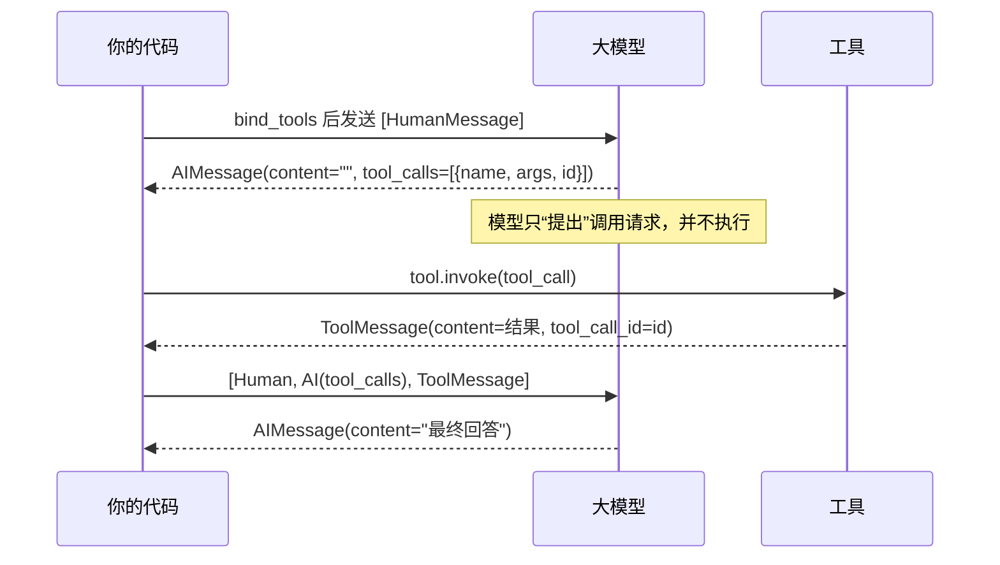

# 第 3 章：工具与工具调用（LangChain）

> 练习：`exercises/ch03_tools.py`　验证：`uv run python check.py 3`

## 1. 为什么需要工具

大模型的知识有截止日期、不能访问你的数据库、算术也不可靠。**工具（Tool）** 让模型可以“借助外力”：查询实时数据、调用 API、执行计算等。

## 2. 关键概念

### 2.1 用 `@tool` 定义工具

```python
from langchain_core.tools import tool

@tool
def search_order(order_id: str) -> str:
    """根据订单号查询订单状态。order_id 形如 A1001。"""
    return {"A1001": "已发货"}.get(order_id, "订单不存在")

search_order.name         # "search_order"
search_order.description  # 来自 docstring
search_order.args         # {'order_id': {'type': 'string', ...}} 来自类型注解
search_order.invoke({"order_id": "A1001"})   # "已发货"
```

**函数名、docstring、参数类型注解**会被转成 JSON Schema 发给模型。模型完全依赖这些信息决定是否调用、怎么传参，所以 docstring 要写清楚“做什么、参数是什么格式”。

### 2.2 工具调用的完整流程



关键点：

1. **`model.bind_tools(tools)`**：把工具说明附加到每次请求上。返回一个新的 Runnable，原模型不变。
2. **`AIMessage.tool_calls`**：模型想调用工具时，回复的 `content` 通常为空，`tool_calls` 是一个列表（模型可以一次要求调用多个工具）：
   ```python
   [{"name": "search_order", "args": {"order_id": "A1001"}, "id": "call_abc", "type": "tool_call"}]
   ```
3. **`ToolMessage`**：工具结果必须包装成 `ToolMessage`，并通过 `tool_call_id` 与对应的调用关联。
   小技巧：`tool.invoke(tool_call)`（传入整个 tool_call 字典）会直接返回填好 `tool_call_id` 的 `ToolMessage`。
4. **模型不会执行工具**，执行是你的代码（或后面的 `ToolNode`）负责的。这也意味着你可以在执行前做校验、审批（第 7、8 章）。

### 2.3 错误处理原则

工具出错时，**不要让程序崩溃**，而是把错误信息作为 `ToolMessage` 返回给模型。模型看到“没有这个工具”或“参数格式错误”后，常常能自己纠正。

## 3. 使用场景

- 查询类：天气、股价、订单、数据库、搜索引擎
- 计算类：数学计算、代码执行
- 操作类：发邮件、写文件、下单（通常需要人工确认）

## 4. 练习清单

| 编号 | 内容 | 要点 |
| --- | --- | --- |
| 3.1 | `multiply` 工具 | `@tool` + 类型注解 + docstring |
| 3.2 | `get_weather` 工具 | 查字典，处理未知城市 |
| 3.3 | `TOOLS` 列表 | |
| 3.4 | `execute_tool_calls` | 按名字找工具、`invoke(tool_call)`、未知工具返回错误 ToolMessage |
| 3.5 | `run_one_round` | **手写一轮 Agent**：bind_tools → invoke → 执行工具 → 再 invoke |

## 5. 思考题

`run_one_round` 只处理了“一轮”。如果第二次调用模型后，它又要求调用另一个工具呢？你会怎么改？
—— 写一个 `while` 循环当然可以，但当流程再加上分支、审批、记忆时，代码会迅速变得难以维护。这就是下一章引入 LangGraph 的原因。
