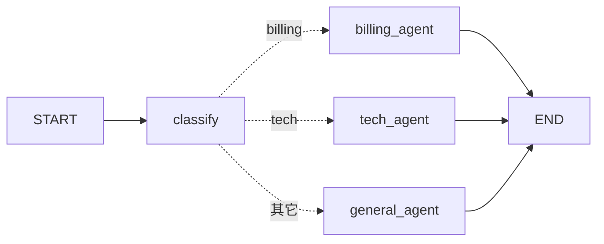
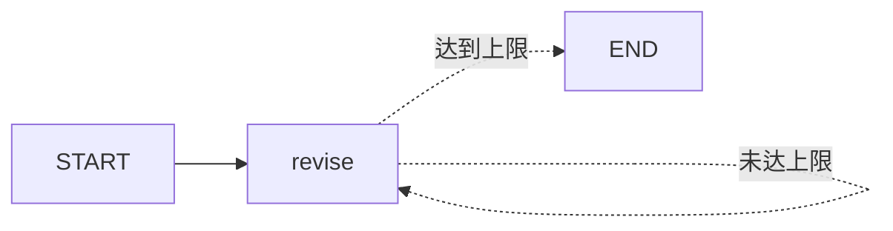

# 第 5 章：条件边（路由）与循环（LangGraph）

> 练习：`exercises/ch05_routing_loops.py`　验证：`uv run python check.py 5`

## 1. 关键概念

### 1.1 条件边：运行时决定下一步

普通边是固定的；**条件边**由一个“路由函数”根据当前状态决定去哪：

```python
def route_by_score(state) -> str:
    return "pass_node" if state["score"] >= 60 else "retry_node"

builder.add_conditional_edges(
    "grade",                       # 源节点
    route_by_score,                # 路由函数：返回下一个节点名（或 END）
    ["pass_node", "retry_node"],   # 可能的目标列表（可选，用于画图和校验）
)
```

也可以传一个映射字典，把路由函数的返回值映射成节点名：

```python
builder.add_conditional_edges("grade", lambda s: s["score"] >= 60, {True: "pass_node", False: "retry_node"})
```

**职责分离**：节点负责“做事并更新状态”，路由函数只负责“读状态、做决定”，不修改状态。



### 1.2 循环：边指回上游节点

条件边可以指向自己或之前的节点，从而形成循环。**循环必须有退出条件**：

```python
def check(state):
    return END if state["ok"] or state["tries"] >= 3 else "attempt"

builder.add_edge(START, "attempt")
builder.add_conditional_edges("attempt", check, ["attempt", END])
```



### 1.3 递归上限 recursion_limit

为防止死循环，LangGraph 默认最多执行 25 步（super-step），超过会抛出 `GraphRecursionError`。可以在调用时调整：

```python
graph.invoke(inputs, {"recursion_limit": 50})
```

## 2. 使用场景

- **路由**：意图识别后分发给不同的处理流程（客服分流、多 Agent 中的“主管”分派任务）
- **循环**：自我反思/改进（生成 → 评审 → 不合格就重写）、失败重试、以及最重要的 —— **Agent 的工具调用循环**（下一章）

## 3. 练习清单

| 编号 | 内容 | 要点 |
| --- | --- | --- |
| 5.1 | `classify` | 关键词分类，返回 `{"category": ...}` |
| 5.2 | `route_by_category` | 路由函数返回节点名 |
| 5.3 | `build_router_graph` | `add_conditional_edges` |
| 5.4 | `revise` | 计数 + 修改草稿 |
| 5.5 | `should_continue` | 返回 `"revise"` 或 `END` |
| 5.6 | `build_loop_graph` | 条件边指回自身 |

## 4. 思考题

真实项目里 `classify` 会交给大模型来做。结合第 2 章的结构化输出，你会怎样设计这个节点？
（提示：定义 `class Category(BaseModel): category: Literal["billing", "tech", "general"]`，再 `llm.with_structured_output(Category)`。）
