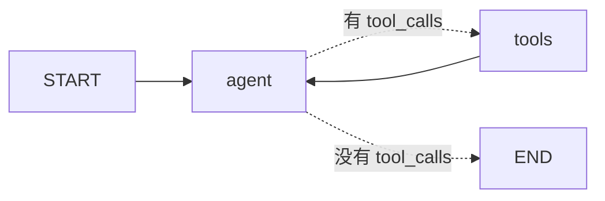

# 第 6 章：手写 ReAct Agent（LangChain + LangGraph）

> 练习：`exercises/ch06_react_agent.py`　验证：`uv run python check.py 6`

## 1. 把前面学的拼起来

- 第 3 章：一轮工具调用（模型 → 工具 → 模型）
- 第 5 章：条件边 + 循环

两者结合，就是一个完整的 **ReAct Agent**：



## 2. 关键概念

### 2.1 MessagesState

LangGraph 内置的状态，只有一个 `messages` 字段，reducer 为 `add_messages`：节点返回 `{"messages": [新消息]}` 就会被追加到历史中。

```python
from langgraph.graph import MessagesState
graph.invoke({"messages": [("human", "你好")]})   # 元组会被自动转换成 HumanMessage
```

需要额外字段时可以继承：`class MyState(MessagesState): user_name: str`

### 2.2 模型节点

```python
def make_node(model, tools):
    bound = model.bind_tools(tools)          # 在外层只绑定一次
    def node(state: MessagesState):
        return {"messages": [bound.invoke(state["messages"])]}
    return node
```

**System 提示词放哪里？** 推荐在调用模型时临时拼接在最前面，而**不存进状态**：这样修改提示词不会影响已存档的历史，历史里也不会堆积重复的 system 消息。

### 2.3 ToolNode

`langgraph.prebuilt.ToolNode(tools)` 是预置节点：读取最后一条 `AIMessage` 的所有 `tool_calls`，（并行）执行对应工具，返回 `ToolMessage` 列表。通过 `handle_tool_errors` 参数，可以把工具异常转换成错误信息返回给模型（例如 `ToolNode(tools, handle_tool_errors=True)`），而不是让整个图崩溃。

它做的事情和你在第 3 章写的 `execute_tool_calls` 本质相同。

### 2.4 路由：tools_condition

`langgraph.prebuilt.tools_condition` 是预置的路由函数：最后一条消息有 `tool_calls` 就返回 `"tools"`，否则返回 `END`。本章要求你自己实现一遍。

### 2.5 一行版：create_agent

LangChain 1.x 提供了 `create_agent`，内部构建的就是上面这张图：

```python
from langchain.agents import create_agent

agent = create_agent(model, tools=[...], system_prompt="你是...")
agent.invoke({"messages": [("human", "...")]})
```

它还支持 **middleware（中间件）**，用于添加人工审批、对话摘要、调用次数限制等能力，例如 `HumanInTheLoopMiddleware`。

### 2.6 那为什么还要手写？

| | `create_agent` | 手写 `StateGraph` |
| --- | --- | --- |
| 上手速度 | 一行代码 | 需要理解图 |
| 标准 ReAct 循环 | 足够 | 也可以 |
| 自定义流程（审批分支、多 Agent、并行子任务、自定义状态字段） | 受限于中间件能提供的扩展点 | 完全自由 |
| 调试与理解 | 黑盒 | 每一步都清清楚楚 |

建议：**理解原理后，简单场景用 `create_agent`；流程有定制需求时手写图。** 第 8 章的审批流程就是手写的。

## 3. 观察 Agent 的思考过程

```python
for state in agent.stream({"messages": [("human", "...")]}, stream_mode="values"):
    state["messages"][-1].pretty_print()
```

`stream_mode` 常用取值：

- `"values"`：每一步之后输出完整状态
- `"updates"`：每一步只输出该节点返回的更新
- `"messages"`：逐 token 输出模型生成内容（用于做打字机效果）

## 4. 练习清单

| 编号 | 内容 | 要点 |
| --- | --- | --- |
| 6.1 | `make_call_model_node` | 工厂函数、bind_tools、临时拼接 SystemMessage |
| 6.2 | `should_continue` | 检查最后一条消息的 `tool_calls` |
| 6.3 | `build_agent_graph` | agent / tools 两个节点 + 循环 |
| 6.4 | `build_prebuilt_agent` | `create_agent` |

## 5. 动手实验（需要 .env）

运行 `uv run python -m exercises.ch06_react_agent`，观察模型如何先查两只股票的价格，再调用计算器求和。试着把 `SYSTEM_PROMPT` 中“不要心算”去掉，看看行为有没有变化。
