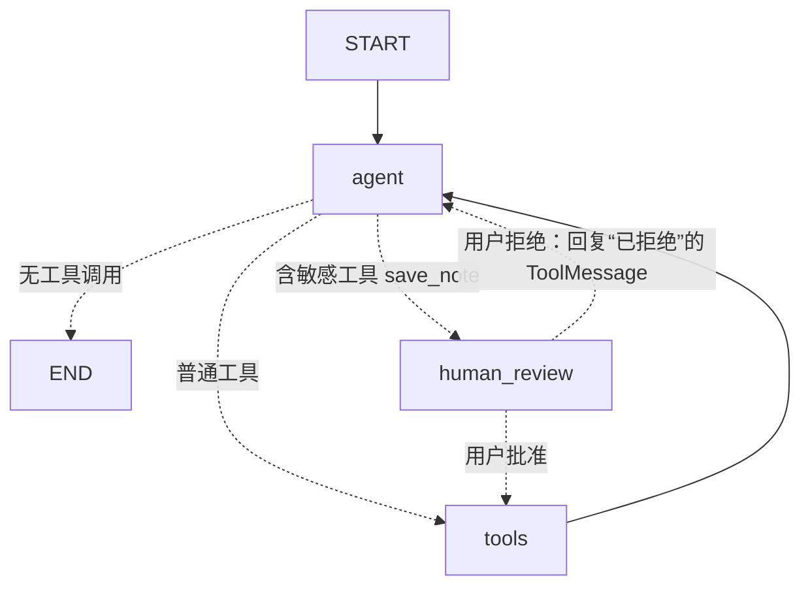

# 第 8 章：综合项目 —— 学习助理 Agent

> 练习：`exercises/ch08_final_agent/`　验证：`uv run python check.py 8`
> 运行：`uv run python -m exercises.ch08_final_agent.app`（需要 .env）

## 1. 项目目标

做一个能帮你复习 LangChain / LangGraph 的命令行学习助理，它能：

| 能力 | 实现方式 | 对应知识点 |
| --- | --- | --- |
| 查询概念 | `search_knowledge` 工具查本地知识库 | 第 3 章 工具 |
| 精确计算 | `calculator` 工具（安全求值） | 第 3 章 工具 |
| 记笔记 / 看笔记 | `save_note` / `list_notes` 工具 | 第 3 章 工具 |
| 多步推理 | ReAct 循环 | 第 5、6 章 |
| 记笔记前征得同意 | `human_review` 节点 + `interrupt` | 第 7 章 人在回路 |
| 记住上下文 | Checkpointer + thread_id | 第 7 章 记忆 |

## 2. 架构



文件结构：

```
exercises/ch08_final_agent/
├── knowledge.py   # 知识库数据（已提供）
├── tools.py       # 工具定义（练习 8.1-8.5）
├── graph.py       # Agent 图（练习 8.6-8.9）
└── app.py         # 命令行程序（练习 8.10；界面部分已提供）
```

## 3. 推荐的完成顺序

1. **tools.py**：先写工具，它们是独立的纯函数，最容易测试。
   `uv run pytest tests/test_ch08_final_agent.py -k "8_1 or 8_2 or 8_3 or 8_5" -v`
2. **graph.py**：`make_agent_node` → `route_after_agent` → `build_study_agent`（这时 human_review 还没写，可以先跑 `-k "8_6 or 8_7 or direct or search"`）→ 最后写 `human_review`。
3. **app.py**：实现 `run_turn`。
4. `uv run python check.py 8` 全部通过。
5. 配置 `.env`，用真实模型运行。

## 4. 设计要点

### 4.1 为什么审批要放在图里，而不是放在工具函数里？

把 `input("确认吗？")` 写进 `save_note` 也能“审批”，但这样：
- 工具与命令行界面耦合，换成 Web 界面就要改工具
- 无法暂停后过一段时间再恢复（比如等管理员审批）

用 `interrupt` 后，图只负责“在这里停下、把待审批内容交出去”，**由调用方（命令行、Web、消息队列……）决定怎么问人**。`run_turn` 的 `ask_approval` 参数正是这种解耦的体现。

### 4.2 拒绝时为什么要回 ToolMessage？

主流模型 API 规定：带 `tool_calls` 的 AIMessage 之后，必须为每个 `tool_call_id` 都提供一条 ToolMessage。把“用户拒绝了”当作工具结果交给模型，既满足协议，又能让模型向用户解释，而不是直接卡住。

### 4.3 为什么 run_turn 用 while 而不是 if？

恢复执行后，模型可能再次调用敏感工具（比如用户让它记两条笔记，它分两次调用），图会再次暂停。

## 5. 用真实模型验收

```bash
cp .env.example .env    # 填入你的 API Key、Base URL、模型名
uv run python -m exercises.ch08_final_agent.app
```

建议的对话脚本（检验每项能力）：

```
你 > 什么是 Checkpointer？                       ← 应调用 search_knowledge
你 > 如果我每天学 1.5 小时，学 3 周一共多少小时？    ← 应调用 calculator
你 > 把 Checkpointer 的解释记成一条笔记             ← 应弹出审批，输入 y
你 > 再帮我记一条关于 interrupt 的笔记              ← 弹出审批，输入 n，助理应说明已取消
你 > 我现在有哪些笔记？                           ← 应调用 list_notes，只有一条
你 > 我刚才第一个问题问的是什么？                   ← 测试记忆
/new
你 > 我刚才第一个问题问的是什么？                   ← 新会话，应该不知道
```

## 6. 进阶挑战（可选，没有测试，自由发挥）

1. **持久化**：把 `InMemorySaver` 换成 SQLite（`uv add langgraph-checkpoint-sqlite`，使用 `SqliteSaver`），重启程序后记忆仍在；把 `NOTES` 也改成写入文件。
2. **流式输出**：在 app 中使用 `app.stream(..., stream_mode="messages")` 实现打字机效果。
3. **RAG**：把关键词搜索换成向量检索（`langchain-openai` 的 `OpenAIEmbeddings` + `InMemoryVectorStore`）。
4. **对比实现**：用 `create_agent(model, tools, middleware=[HumanInTheLoopMiddleware(interrupt_on={"save_note": True})], checkpointer=...)` 实现同样的功能，对比与手写图的差异。
5. **可观测性**：注册 LangSmith，设置 `LANGSMITH_TRACING=true` 和 `LANGSMITH_API_KEY`，在网页上查看每一次模型调用和工具调用的完整链路。
6. **新工具**：加一个 `quiz(topic)` 工具，让助理基于知识库给你出题。
